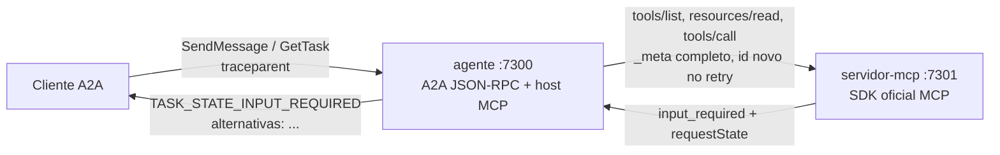

<!-- TOC -->
- [A Ponte: agente A2A com MCP por dentro](#a-ponte-agente-a2a-com-mcp-por-dentro)
  - [Como rodar](#como-rodar)
    - [Com Docker (recomendado)](#com-docker-recomendado)
    - [Sem Docker (um processo por terminal)](#sem-docker-um-processo-por-terminal)
    - [A chave do requestState](#a-chave-do-requeststate)
    - [Testes, portas e demais comandos](#testes-portas-e-demais-comandos)
  - [Onde a ponte acontece](#onde-a-ponte-acontece)
  - [Decisões técnicas](#decisões-técnicas)
  - [Saída do validador](#saída-do-validador)
  - [Documentação](#documentação)
  - [Desenvolvedor](#desenvolvedor)
  - [Licença](#licença)
<!-- TOC -->

# A Ponte: agente A2A com MCP por dentro

Central de Salas da Hill Valley Tech: um **servidor MCP** (Streamable HTTP, stateless) expõe as salas como ferramentas, e um **agente** é host MCP por dentro e servidor **A2A v1.0** por fora. Quando a sala está ocupada, o `input_required` do MCP vira `TASK_STATE_INPUT_REQUIRED` no A2A, e a resposta do cliente volta ao MCP como um retry com id novo. Essa costura é a ponte.

- Versão: `0.1.0` (arquivo [VERSION](VERSION))
- Validador oficial: **36/36** (saída completa [abaixo](#saída-do-validador))
- Sem LLM: o agente interpreta um formato fixo e decide por regra, de forma determinística
- Documentação completa: [docs/](docs/README.md)



## Como rodar

Requisitos: Ubuntu 22.04/24.04/26.04 (amd64) ou macOS (amd64/arm64, com Colima), Docker com Compose v2, `make`, `curl` e `git`. O passo a passo de instalação por sistema operacional está em [REQUIREMENTS.md](REQUIREMENTS.md).

### Com Docker (recomendado)

A partir de um clone limpo:

```bash
git clone https://github.com/aeciopires/desafio-a2a-com-mcp.git
cd desafio-a2a-com-mcp
make check-os              # confere se o SO é suportado
make install               # instala o mise (sem sudo), Python 3.14 e uv, dependências; cria .env com os segredos
make check-dependencies    # confere Docker, Compose, buildx, daemon e portas livres
make up                    # sobe agente, servidor MCP, Prometheus, Grafana, Jaeger, Loki e Alloy
make validate              # roda o validador oficial com os processos recém-iniciados
make logs-mcp              # stderr do servidor MCP (method, id e traceparent de cada request)
make down                  # para tudo
```

O validador também pode ser chamado direto (Python 3.10 ou superior):

```bash
python3 validador/validar.py --agente http://localhost:7300 --mcp http://localhost:7301
```

Rode o validador sempre com os processos recém-iniciados: as reservas de uma execução mudam o resultado da seguinte. `make validate` já faz `make restore` (recria agente e servidor MCP com os dados iniciais) antes de rodar.

### Sem Docker (um processo por terminal)

```bash
make install                 # uma vez: mise, Python, uv, dependências e .env com REQUEST_STATE_SECRET
make run-mcp                 # terminal 1: servidor MCP em :7301 (stderr visível)
make run-agent               # terminal 2: agente em :7300
python3 validador/validar.py --agente http://localhost:7300 --mcp http://localhost:7301   # terminal 3
```

### A chave do requestState

O servidor só sobe com `REQUEST_STATE_SECRET` definido (mínimo 32 bytes). `make install` e `make secret` geram a chave no `.env`, e só se ela estiver vazia. Para gerar e exportar manualmente:

```bash
python3 -c "import secrets; print(secrets.token_hex(32))"
export REQUEST_STATE_SECRET=<valor gerado>
```

O `.env` não é versionado; o [.env.example](.env.example) traz só os nomes das variáveis.

### Testes, portas e demais comandos

| Comando | O que faz |
|---|---|
| `make help` | lista todos os alvos |
| `make test-unit` / `make test-integration` / `make tests` | testes (sobem a stack antes e derrubam depois) |
| `make restore` / `make restart-mcp` | dados iniciais / reinicia só o servidor MCP |
| `make build` / `make build-multiarch` | imagens `desafio-a2a/*:0.1.0` (nativa / linux amd64+arm64) |
| `make observability` / `make traces TRACE_ID=<id>` | saúde e links de Grafana, Prometheus, Jaeger, Loki e Alloy |
| `make lint` / `make fmt` / `make toc` | qualidade de código e TOC dos `.md` |

| Serviço | URL padrão | Variável para trocar a porta |
|---|---|---|
| Agente A2A | http://localhost:7300/a2a, card em `/.well-known/agent-card.json`, Swagger em `/docs` | `AGENT_PORT` |
| Servidor MCP | http://localhost:7301/mcp, Swagger em `/docs` | `MCP_PORT` |
| Grafana | http://localhost:3000 (admin / `GRAFANA_ADMIN_PASSWORD` do `.env`) | `GRAFANA_PORT` |
| Prometheus / Jaeger / Loki / Alloy | :9090 / :16686 / :3100 / :12345 | `PROMETHEUS_PORT`, `JAEGER_UI_PORT`, `LOKI_PORT`, `ALLOY_UI_PORT` |

Se uma porta estiver ocupada, `make up` mostra qual processo a ocupa e sugere a troca (ex.: `echo 'MCP_PORT=7311' >> .env`). Veja [docs/variaveis-de-ambiente.md](docs/variaveis-de-ambiente.md) e [docs/troubleshooting.md](docs/troubleshooting.md).

## Onde a ponte acontece

A ponte inteira está em [agente/src/agent/bridge.py](agente/src/agent/bridge.py).

- **MCP → A2A.** O `tools/call reservar_sala` é feito em `Bridge.start` ([bridge.py:76](agente/src/agent/bridge.py#L76)). Quando o resultado é um `InputRequiredResult` ([bridge.py:141](agente/src/agent/bridge.py#L141)), entra `Bridge._pause` ([bridge.py:162](agente/src/agent/bridge.py#L162)):
  - guarda **na própria Task** a chave do `inputRequests`, o `requestState`, os argumentos originais e as opções do `enum` (`task.pending = PendingInput(...)`, [bridge.py:178](agente/src/agent/bridge.py#L178));
  - move a Task para `TASK_STATE_INPUT_REQUIRED` com a linha `alternativas: ...` ([bridge.py:185](agente/src/agent/bridge.py#L185)).
- **A2A → MCP.** O `SendMessage` de continuação (`taskId` + `escolha=...`) chega em `Bridge.resume` ([bridge.py:89](agente/src/agent/bridge.py#L89)). Ele repete o `tools/call` com os mesmos argumentos, `inputResponses` sob a mesma chave e o `requestState` ecoado sem modificação ([bridge.py:126-127](agente/src/agent/bridge.py#L126-L127)). O id JSON-RPC novo vem do contador do `McpHost.request` ([mcp_host.py:66](agente/src/agent/mcp_host.py#L66)), e o `requestState` entra no request intacto em [mcp_host.py:198](agente/src/agent/mcp_host.py#L198).
- **Do lado do servidor:** o resolver `escolha_de_sala` ([server.py:93](servidor-mcp/src/mcp_server/server.py#L93)) devolve `Elicit(...)` no conflito. O SDK transforma isso no `input_required` e, no retry, verifica o lacre do `requestState` antes de rodar a tool ([server.py:120](servidor-mcp/src/mcp_server/server.py#L120)).

O `requestState` nunca é aberto pelo agente e nunca sai numa resposta A2A: `Task.to_wire()` serializa por lista de permissão ([tasks.py:131](agente/src/agent/tasks.py#L131)). Diagramas em [docs/fluxos.md](docs/fluxos.md).

## Decisões técnicas

- **Proteção do `requestState`:** usamos o `RequestStateBoundary` do SDK oficial (`mcp` 2.3.0). Ele sela o estado com **AES-256-GCM** (AEAD, chave derivada por HKDF-SHA256 de `REQUEST_STATE_SECRET`) e vincula o envelope ao método, à tool, ao **digest dos argumentos originais** e à audiência. Qualquer caractere trocado, argumento alterado ou estado expirado resulta em `-32602`. O servidor não guarda nada entre as rodadas, então um retry depois de reiniciar o processo funciona, desde que o segredo seja o mesmo. Detalhes em [docs/request-state.md](docs/request-state.md).
- **Validade:** `REQUEST_STATE_TTL_SECONDS`, padrão **600 s (10 min)**. A configuração só aceita valores entre 5 e 30 minutos.
- **Estado das Tasks:** `TaskStore` em memória no agente ([tasks.py](agente/src/agent/tasks.py)), com um lock por Task. O estado da ponte fica no campo privado `Task.pending`, nunca serializado. Tasks e reservas não sobrevivem a um restart, o que o enunciado aceita.
- **Cliente MCP do agente:** um cliente fino sobre `httpx`, com os tipos do SDK (`mcp_types`). O `Client` do SDK resolveria o `input_required` sozinho via callback, e então a Task nunca pausaria. Além disso, com o callback ele declara `elicitation: {form, url}`, e o enunciado exige exatamente `{"elicitation": {"form": {}}}`.
- **A2A feito à mão:** o `a2a-sdk` 1.2.2 trata request sem o header `A2A-Version` como v0.3 e responde `-32009 VERSION_NOT_SUPPORTED`. Nem os exemplos de wire nem o validador enviam esse header. O binding JSON-RPC v1.0 (`SendMessage`, `GetTask`) segue o formato de `exemplos/wire/`.
- **Stack:** Python 3.14.8 via mise, uv com versões travadas, Docker Compose, e Prometheus, Grafana, Jaeger 2.22 (lido pelo Grafana via `/api/v3`, com o feature toggle `jaegerEnableGrpcEndpoint`), Loki 3.7.8 e Alloy 1.21.0 (imagens fixadas pela tag exata, sem digest), com métricas, traces e logs correlacionados pelo trace-id.

Todas as decisões, com justificativas: [docs/decisoes-tecnicas.md](docs/decisoes-tecnicas.md).

## Saída do validador

Última execução (`make validate`, stack Docker recém-iniciada):

```text
trace-id desta execucao: 1199e080b089290aea647c7761507508
procure esse valor no stderr do servidor MCP para conferir a propagacao do traceparent.

PASS 01 tools/list traz as tres tools
PASS 02 toda tool tem inputSchema de objeto
PASS 03 listar_salas devolve structuredContent e o mesmo JSON em texto
PASS 04 _meta sem protocolVersion devolve -32602 e HTTP 400
PASS 05 _meta sem clientCapabilities devolve -32602 e HTTP 400
PASS 06 tool inexistente e recusada, por -32602 ou por isError
PASS 07 resources/read de politica://uso devolve a politica
PASS 08 resources/read de URI inexistente devolve -32602
PASS 09 sala inexistente devolve isError com a mensagem exata
PASS 10 fora da janela devolve isError com a mensagem exata
PASS 11 duracao acima de 2h devolve isError com a mensagem exata
PASS 12 intervalo invertido devolve isError com a mensagem exata
PASS 13 conflito devolve input_required com inputRequests e requestState
PASS 14 a elicitation e form mode e oferece as alternativas na ordem certa
PASS 15 conflito sem a capability elicitation devolve -32021 e HTTP 400
PASS 16 retry com inputResponses e requestState conclui a reserva
PASS 17 requestState adulterado e rejeitado com -32602
PASS 18 argumentos adulterados no retry nao tomam efeito
PASS 19 recusa conclui sem reservar e sem isError
PASS 20 conflito sem alternativa possivel devolve isError com a mensagem exata

PASS 21 agent card responde 200 no well-known com JSON
PASS 22 o card declara a interface JSON-RPC com url e versao 1.0
PASS 23 o card declara a skill reservar-sala
PASS 24 SendMessage com sala livre conclui a Task
PASS 25 o artifact chama reserva e traz a versao da politica
PASS 26 GetTask devolve id, contextId e estado corrente
PASS 27 SendMessage com sala ocupada pausa a Task
PASS 28 a Task pausada lista as alternativas na ordem certa
PASS 29 escolha fora do enum mantem a Task pausada
PASS 30 a continuacao conclui a Task na sala escolhida
PASS 31 SendMessage em Task terminal e recusado
PASS 32 a recusa termina a Task em CANCELED
PASS 33 duas Tasks pausadas ao mesmo tempo concluem cada uma com a sua reserva
PASS 34 nenhuma resposta A2A carrega o requestState
PASS 35 sala inexistente termina a Task em FAILED com a mensagem da tool
PASS 36 o agente e deterministico: o mesmo pedido produz a mesma pausa

resumo: 36 passaram, 0 falharam, de 36 verificacoes
```

## Documentação

| | |
|---|---|
| [docs/](docs/README.md) | arquitetura, fluxos, estados, classes, testes, observabilidade, tracing, Swagger, variáveis, troubleshooting, glossário (com diagramas Mermaid e analogias) |
| [REQUIREMENTS.md](REQUIREMENTS.md) | dependências por sistema operacional, automáticas e manuais |
| [CONTRIBUTING.md](CONTRIBUTING.md) | como contribuir |
| [CHANGELOG.md](CHANGELOG.md) | histórico de mudanças por versão (Versionamento Semântico) |
| [CLAUDE.md](CLAUDE.md) | regras para manter o repositório consistente com o [TASK.md](TASK.md) |
| [PLAN.md](PLAN.md) | plano de implementação |

## Desenvolvedor

- Aécio Pires, [linktr.ee/aeciopires](https://linktr.ee/aeciopires)

## Licença

MIT License, veja [LICENSE](LICENSE).
