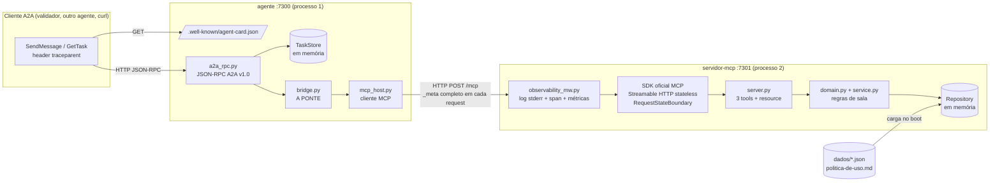
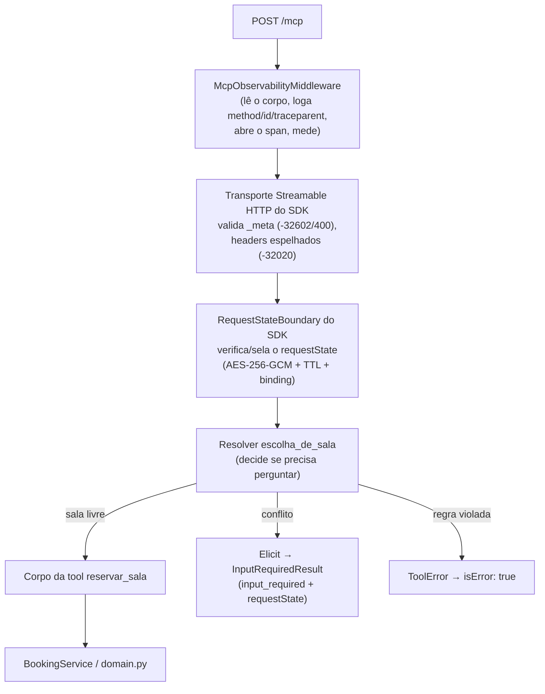
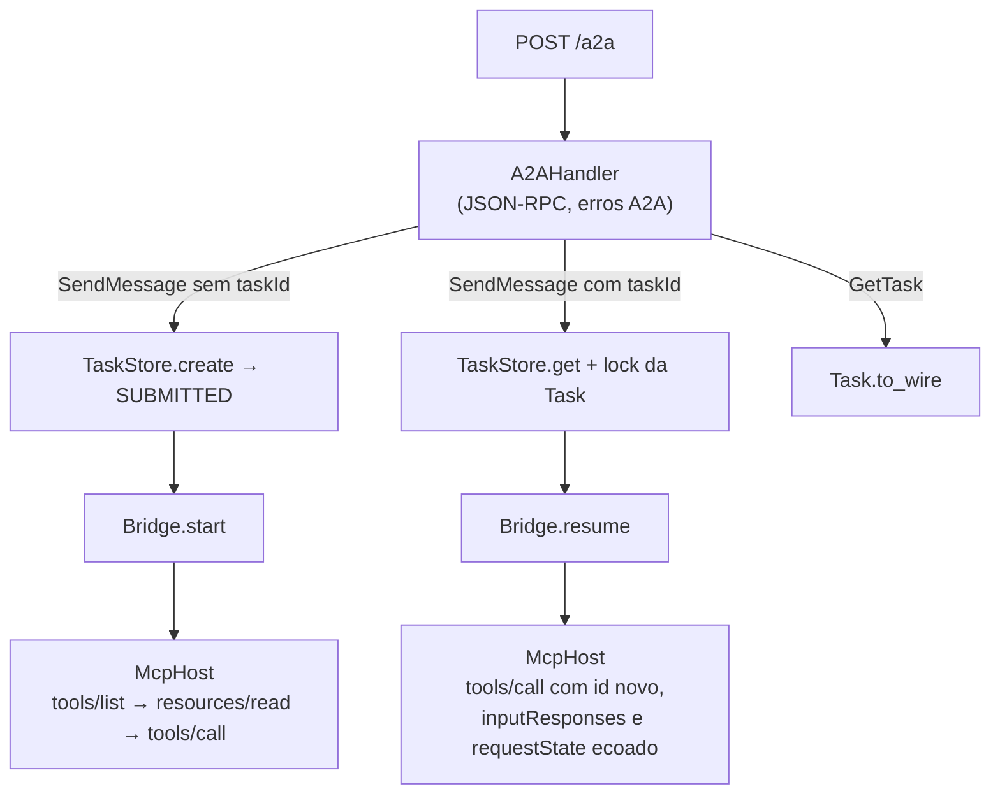
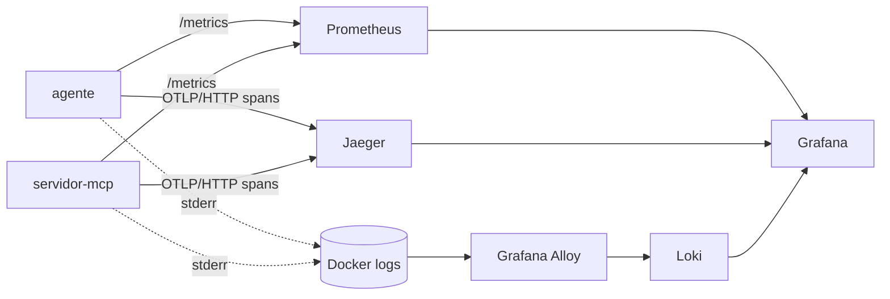

<!-- TOC -->
- [Arquitetura](#arquitetura)
  - [A ideia em uma frase](#a-ideia-em-uma-frase)
  - [Visão geral dos processos](#visão-geral-dos-processos)
  - [Camadas do servidor MCP](#camadas-do-servidor-mcp)
  - [Camadas do agente](#camadas-do-agente)
  - [Observabilidade em volta](#observabilidade-em-volta)
  - [Onde ficam as coisas](#onde-ficam-as-coisas)
<!-- TOC -->

# Arquitetura

## A ideia em uma frase

O **agente** é a recepção de um prédio: quem chega de fora (outro agente, via **A2A**) fala só com a recepcionista. Ela não decide nada sobre as salas; liga para o ramal da administração (o **servidor MCP**), que conhece as regras, e repassa a resposta. Quando a administração diz "essa sala está ocupada, qual destas serve?", a recepcionista não escolhe por conta própria: devolve a pergunta ao visitante e guarda o protocolo da ligação até ele responder.

## Visão geral dos processos

- **Dois processos separados**, falando HTTP como cliente e servidor MCP de verdade. Nenhum importa código do outro.
- **O agente traduz protocolo, não domínio.** Conflito, política e alternativas são decididos só no servidor MCP.
- **Nenhum dos lados tem sessão.** Cada request MCP leva `protocolVersion` e `clientCapabilities` no `_meta`; o estado de uma pausa viaja no `requestState` (MCP) e fica guardado na Task (A2A).

## Camadas do servidor MCP

Analogia do servidor: é um **cartório**. Ele não guarda conversa com ninguém; cada pedido precisa vir com todos os documentos (o `_meta`). Quando falta uma informação, o cartório entrega um **envelope lacrado** (o `requestState`) com tudo o que já foi analisado e pede que você volte com ele e com a resposta. Se o lacre estiver violado, o pedido é recusado.

## Camadas do agente

## Observabilidade em volta

Tudo isso é extra: o desafio exige apenas o log do `traceparent` no stderr do servidor MCP, e os dois processos funcionam com a stack de observabilidade parada. Detalhes em [observabilidade.md](observabilidade.md) e [tracing.md](tracing.md).

## Onde ficam as coisas

| Pasta | Conteúdo |
|---|---|
| [servidor-mcp/src/mcp_server/](../servidor-mcp/src/mcp_server/) | servidor MCP: `server.py` (tools, resource, MRTR), `domain.py` (regras), `observability_mw.py` (log/span/métricas) |
| [agente/src/agent/](../agente/src/agent/) | agente: `a2a_rpc.py` (A2A), `bridge.py` (a ponte), `mcp_host.py` (cliente MCP), `tasks.py` (Task) |
| [tests/integration/](../tests/integration/) | testes de ponta a ponta contra a stack em execução |
| [observability/](../observability/) | Prometheus, Loki, Alloy e Grafana (datasources e dashboards) |
| [scripts/](../scripts/) | checagens do Makefile, gerador de TOC e de dashboards |
