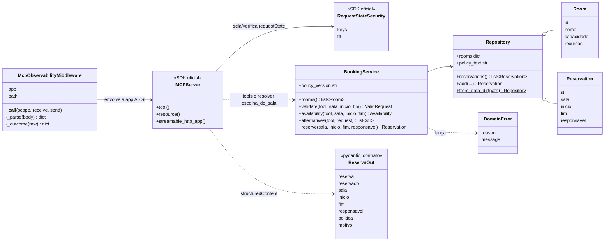
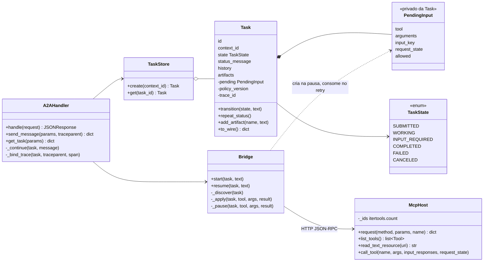

<!-- TOC -->
- [Classes e módulos](#classes-e-módulos)
  - [Servidor MCP](#servidor-mcp)
  - [Agente](#agente)
  - [Analogia](#analogia)
<!-- TOC -->

# Classes e módulos

## Servidor MCP

`domain.py` não tem classes com comportamento: são funções puras (`validate_request`, `conflicts`, `alternatives`, `parse_policy_version`), fáceis de testar.

## Agente

Os resultados MCP são tipados com os modelos do SDK (`mcp_types.CallToolResult`, `mcp_types.InputRequiredResult`, `mcp_types.ElicitRequest`, `mcp_types.ElicitResult`).

## Analogia

- `McpHost` é o **telefone** da recepção: sabe discar (headers, `_meta`, ids novos), mas não sabe o que dizer.
- `Bridge` é a **recepcionista**: decide quando ligar, o que anotar e quando devolver a pergunta ao visitante.
- `Task` é a **ficha do atendimento**: o que o visitante vê (estado, histórico, produto) e um bolso interno (`PendingInput`) com o protocolo da ligação, que o visitante nunca vê.
