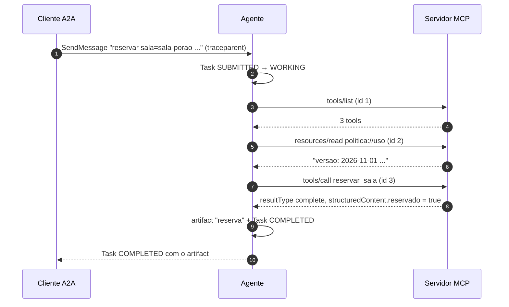
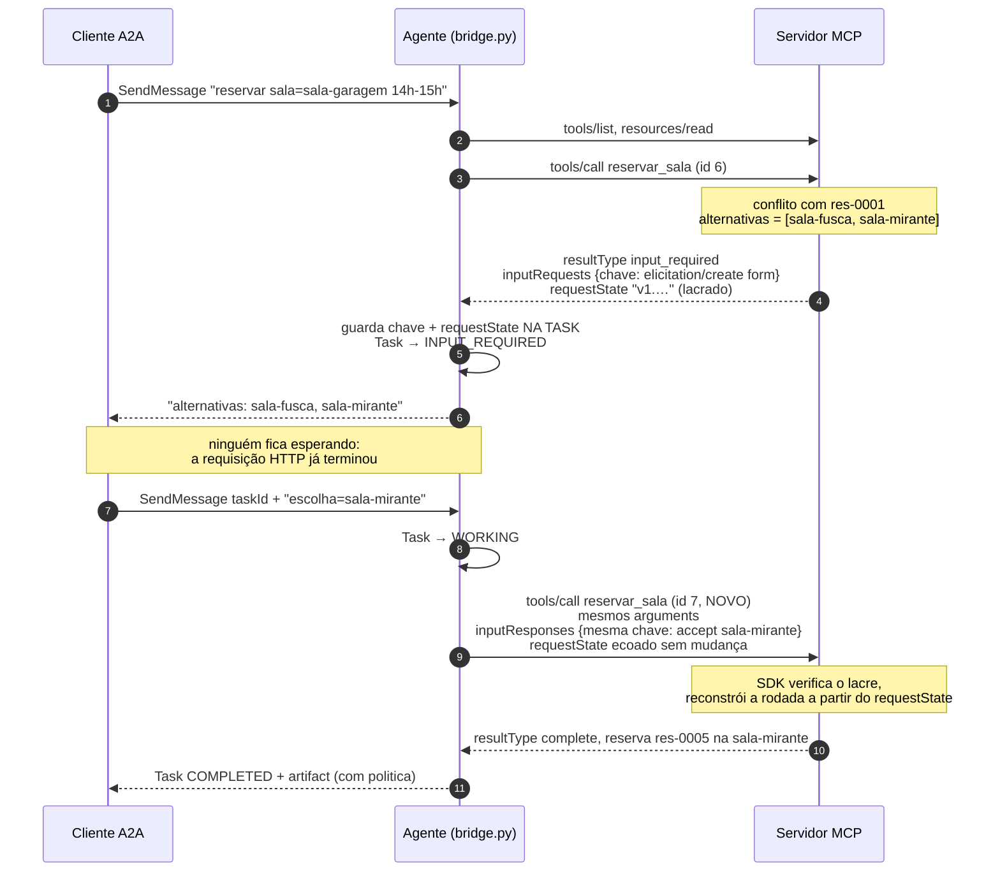
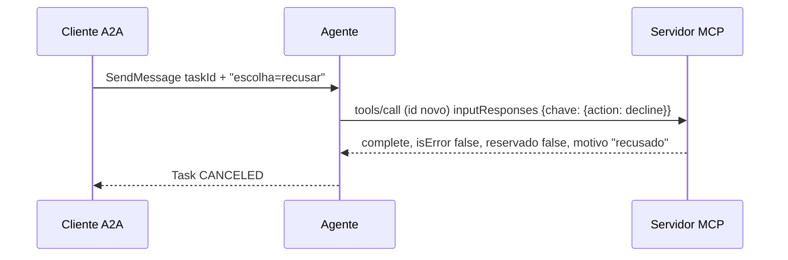
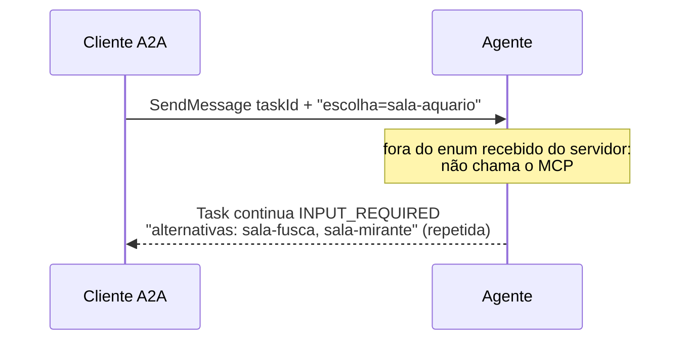
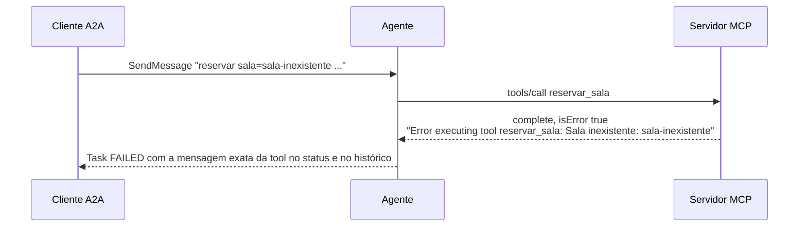
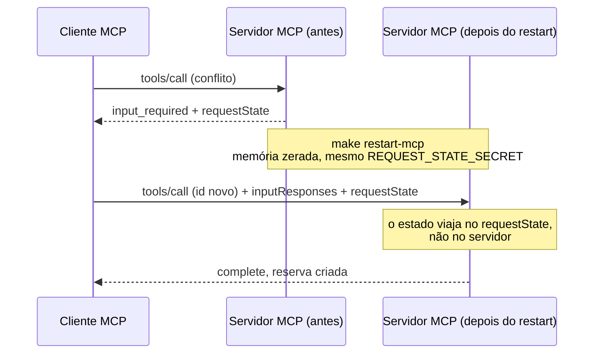

<!-- TOC -->
- [Fluxos da API e dos agentes](#fluxos-da-api-e-dos-agentes)
  - [1. Sala livre (caminho feliz)](#1-sala-livre-caminho-feliz)
  - [2. Sala ocupada: a ponte em ação (MRTR + INPUT_REQUIRED)](#2-sala-ocupada-a-ponte-em-ação-mrtr--input_required)
  - [3. Recusa](#3-recusa)
  - [4. Escolha inválida](#4-escolha-inválida)
  - [5. Erro de regra (sala inexistente, janela, duração, intervalo)](#5-erro-de-regra-sala-inexistente-janela-duração-intervalo)
  - [6. Retry depois de reiniciar o servidor MCP](#6-retry-depois-de-reiniciar-o-servidor-mcp)
  - [7. Rejeições de protocolo](#7-rejeições-de-protocolo)
<!-- TOC -->

# Fluxos da API e dos agentes

Todos os fluxos partem de um `SendMessage` no formato fixo `reservar sala=<id> inicio=<iso8601> fim=<iso8601> responsavel=<nome>`. A resposta a uma pausa é `escolha=<id>` ou `escolha=recusar`.

## 1. Sala livre (caminho feliz)

Analogia: pedir uma mesa num restaurante vazio. O garçom confere o cardápio (`tools/list`), lê as regras da casa (`resources/read`) e confirma a mesa na hora.

## 2. Sala ocupada: a ponte em ação (MRTR + INPUT_REQUIRED)

Analogia: o **garçom** volta da cozinha dizendo "acabou o peixe; pode ser frango ou massa?". Ele não fica parado ao lado do fogão esperando você decidir (não existe canal de volta); ele vai até a mesa, anota a resposta e faz um **pedido novo** para a cozinha, grampeado ao bilhete original.

Os pontos exatos do código estão no [README](../README.md#onde-a-ponte-acontece).

## 3. Recusa

## 4. Escolha inválida

## 5. Erro de regra (sala inexistente, janela, duração, intervalo)

## 6. Retry depois de reiniciar o servidor MCP

## 7. Rejeições de protocolo

| Situação | Resposta |
|---|---|
| `_meta` sem `protocolVersion` ou sem `clientCapabilities` | `-32602`, HTTP 400 |
| Header `Mcp-Method`/`Mcp-Name` diferente do corpo | `-32020` |
| Conflito vindo de cliente sem `elicitation.form` | `-32021`, HTTP 400, `data.requiredCapabilities` |
| `requestState` adulterado, expirado ou com argumentos trocados | `-32602` (`Invalid or expired requestState`) |
| `resources/read` de URI inexistente | `-32602` |
| `SendMessage` para Task terminal | erro A2A `-32004` (UnsupportedOperation) |
| `SendMessage`/`GetTask` de Task inexistente | erro A2A `-32001` (TaskNotFound) |
