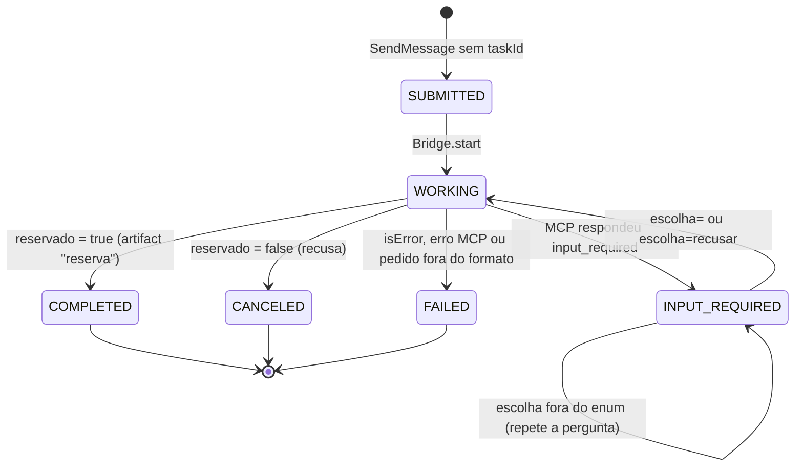

<!-- TOC -->
- [Máquina de estados da Task (A2A)](#máquina-de-estados-da-task-a2a)
  - [Analogia: a senha de atendimento](#analogia-a-senha-de-atendimento)
  - [Regras implementadas (tasks.py)](#regras-implementadas-taskspy)
<!-- TOC -->

# Máquina de estados da Task (A2A)

Os nomes no wire têm o prefixo `TASK_STATE_` (por exemplo `TASK_STATE_INPUT_REQUIRED`).

## Analogia: a senha de atendimento

- **SUBMITTED**: você pegou a senha.
- **WORKING**: o atendente chamou sua senha e está resolvendo.
- **INPUT_REQUIRED**: o atendente pediu um documento que você não trouxe. Sua senha **continua válida**; você sai, busca o documento e volta ao mesmo guichê com a mesma senha (`taskId`).
- **COMPLETED / CANCELED / FAILED**: o atendimento acabou. Para outro assunto, pegue outra senha: a antiga não volta para a fila. É por isso que um `SendMessage` para uma Task terminal é recusado.

## Regras implementadas ([tasks.py](../agente/src/agent/tasks.py))

- Transições fora do diagrama lançam `InvalidTransition` (coberto por teste unitário).
- Estados terminais são definitivos.
- O estado guardado para a ponte (`PendingInput`: chave do `inputRequests`, `requestState`, argumentos originais, opções) é privado da Task. `to_wire()` serializa por lista de permissão (`id`, `contextId`, `status`, `history`, `artifacts`), então ele nunca aparece numa resposta A2A.
- Cada Task tem seu próprio `asyncio.Lock`: duas continuações da mesma Task não disputam o estado; Tasks diferentes não compartilham nada.
