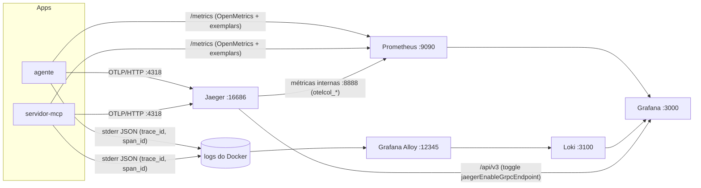
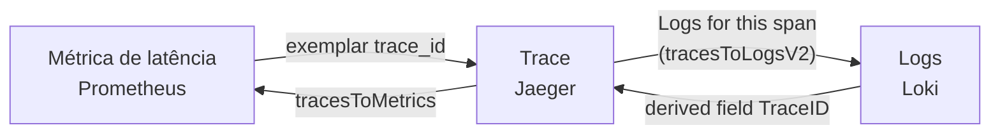

<!-- TOC -->
- [Observabilidade: métricas, traces e logs](#observabilidade-métricas-traces-e-logs)
  - [Analogia: investigar um acidente](#analogia-investigar-um-acidente)
  - [Os três sinais](#os-três-sinais)
  - [Métricas](#métricas)
  - [Dashboards (pasta "Central de Salas")](#dashboards-pasta-central-de-salas)
  - [Logs no Loki](#logs-no-loki)
  - [Correlação no Grafana](#correlação-no-grafana)
    - [Jaeger 2.22 no Grafana](#jaeger-222-no-grafana)
  - [Validação manual](#validação-manual)
<!-- TOC -->

# Observabilidade: métricas, traces e logs

## Analogia: investigar um acidente

- **Métricas** são o velocímetro e o painel: quanto, quantas vezes e quão rápido.
- **Traces** são o GPS: o trajeto completo de um pedido, parada por parada.
- **Logs** são a caixa-preta: cada evento, com detalhes.
- O **trace-id** é a placa do carro: aparece nos três e permite saltar de um para o outro.

## Os três sinais



| Serviço | Imagem | URL | Para quê |
|---|---|---|---|
| Grafana | `grafana/grafana:13.2.4` | http://localhost:3000 | dashboards e Explore (usuário `admin`, senha em `.env`, `GRAFANA_ADMIN_PASSWORD`) |
| Prometheus | `prom/prometheus:v3.15.0` | http://localhost:9090 | métricas e exemplars |
| Jaeger | `jaegertracing/jaeger:2.22.0` | http://localhost:16686 | traces |
| Loki | `grafana/loki:3.7.8` | http://localhost:3100/ready | API de logs (use pelo Grafana) |
| Alloy | `grafana/alloy:v1.21.0` | http://localhost:12345 | UI de depuração do coletor de logs |

As imagens são fixadas pela tag exata, sem digest (veja [decisoes-tecnicas.md](decisoes-tecnicas.md)). `make observability` confere a saúde de todos; `make observability TRACE_ID=<id>` imprime os links diretos.

## Métricas

| Origem | Métrica | Labels |
|---|---|---|
| MCP | `mcp_requests_total` | `method`, `name`, `result_type`, `outcome` |
| MCP | `mcp_request_duration_seconds` (com exemplars) | `method`, `name` |
| MCP | `mcp_protocol_errors_total` | `code` |
| MCP | `mcp_tool_errors_total` | `tool`, `reason` (`sala_inexistente`, `janela`, `duracao`, `intervalo`, `sem_alternativas`, `data_invalida`) |
| MCP | `reservations_created_total` | `room`, `responsible`, `date` |
| MCP | `reservations_active` | `room` |
| MCP | `mrtr_input_required_total` | `tool` |
| MCP | `mrtr_retries_total` | `action` (`accept`, `decline`, `cancel`) |
| MCP | `request_state_rejected_total` | `reason` (`tampered`, `expired`, `mismatch`, `other`) |
| Agente | `a2a_requests_total`, `a2a_request_duration_seconds` (com exemplars) | `method`, `outcome` |
| Agente | `a2a_tasks_total` | `final_state` |
| Agente | `a2a_tasks_by_state` (pausas pendentes = `TASK_STATE_INPUT_REQUIRED`) | `state` |
| Agente | `agent_mcp_calls_total`, `agent_mcp_call_duration_seconds` | `method`, `name`, `result_type` |
| Jaeger (job `jaeger`) | `otelcol_receiver_accepted_spans`, `otelcol_receiver_refused_spans`, `otelcol_exporter_sent_spans`, `otelcol_processor_batch_*` | `receiver`, `transport`, `exporter` |

Não há LLM: as "chamadas ao modelo" deste agente são as chamadas MCP (`agent_mcp_calls_total`).

Os labels `responsible` e `date` têm cardinalidade proporcional ao uso. No volume do desafio isso não é problema; numa adoção real, troque-os por agregações.

## Dashboards (pasta "Central de Salas")

1. **Negócio**: reservas por sala, por responsável e por data; dia com mais reservas; taxa de conflito; aceites x recusas; ocupação atual; erros de regra.
2. **Agente A2A**: confirmações pendentes, Tasks por estado, latência p50/p95 com exemplars, chamadas MCP por Task, logs do agente filtráveis por `task_id`.
3. **MCP e protocolo**: requisições por método, latência por tool com exemplars, erros por código, `requestState` rejeitados, logs do stderr filtráveis por método e `trace_id`.
4. **Correlação** (dashboard inicial): cole o trace-id e veja os logs dos dois serviços, a árvore de spans e as métricas do período.
5. **Jaeger V2 OpenTelemetry Metrics**: saúde do próprio Jaeger (spans recebidos, recusados e gravados, lotes do `batch`). É o dashboard [24836 do grafana.com](https://grafana.com/grafana/dashboards/24836-jaeger-v2-opentelemetry-metrics/), revisão 1.

Os dashboards são gerados por [scripts/gen_dashboards.py](../scripts/gen_dashboards.py) (`make dashboards`); não edite os JSON à mão. O 24836 é a exceção de origem: o JSON baixado fica intacto em [observability/grafana/vendor/](../observability/grafana/vendor/) e o gerador só o adapta (datasource `prometheus` e contadores com ou sem `_total`, porque o Jaeger 2.22 não põe o sufixo). Para atualizar, baixe a nova revisão de `https://grafana.com/api/dashboards/24836/revisions/<n>/download`, troque o arquivo e o nome em `JAEGER_VENDORED` e rode `make dashboards`.

## Logs no Loki

O Alloy ([config.alloy](../observability/alloy/config.alloy)) lê o stdout/stderr dos containers deste projeto pelo socket do Docker e envia ao Loki. Linhas JSON do agente e do servidor são interpretadas:

- labels (baixa cardinalidade): `service`, `container`, `stream`, `level`;
- *structured metadata* (alta cardinalidade): `trace_id`, `span_id`, `method`, `task_id`.

Exemplos de LogQL:

```logql
{service="mcp-server"} | json | method="tools/call"
{service=~"agent|mcp-server"} | trace_id="<trace-id do validador>"
sum by (level) (count_over_time({service="agent"}[5m]))
```

## Correlação no Grafana



| De → Para | Configuração ([datasources.yaml](../observability/grafana/provisioning/datasources/datasources.yaml)) |
|---|---|
| Métrica → trace | Prometheus `exemplarTraceIdDestinations` → `jaeger` |
| Trace → logs | Jaeger `tracesToLogsV2` → `loki`, query `{service="<service.name>"} \| trace_id="<trace>"` |
| Trace → métricas | Jaeger `tracesToMetrics` → `prometheus`, `service.name` → `job` |
| Log → trace | Loki `derivedFields` (structured metadata `trace_id`, ou regex na linha) → `jaeger` |

A cola de tudo é o **mesmo nome de serviço** em três lugares: o `job` do Prometheus, o `service.name` do OpenTelemetry e o label `service` do Loki (`agent` e `mcp-server`).

### Jaeger 2.22 no Grafana

Pense no Jaeger como um arquivo que mudou de balcão de atendimento: o balcão antigo (`/api/services`, `/api/traces` de busca) fechou na 2.21, e só o novo (`/api/v3`) atende. O Grafana só vai ao balcão novo quando recebe o recado `jaegerEnableGrpcEndpoint` (feature toggle no compose).

| Recurso do Grafana | Endpoint do Jaeger 2.22 | Situação |
|---|---|---|
| Health check, lista de serviços e operações | `/api/v3/services`, `/api/v3/operations` | funciona (com o toggle) |
| Trace por id (dashboards, exemplars, links do Loki) | `/api/v3/traces/{id}` | funciona (atributos só string/int, veja [decisoes-tecnicas.md](decisoes-tecnicas.md)) |
| Grafo de dependências | `/api/dependencies` | funciona |
| Busca no Explore (*Search*) | `/api/traces` (removido) | **não funciona**: use a UI do Jaeger |

O teste `test_grafana_reads_jaeger_v2_through_api_v3` cobre as três primeiras linhas.

## Validação manual

1. `make up` e `make validate`.
2. Copie o trace-id da primeira linha da saída do validador.
3. Abra http://localhost:3000, dashboard **Correlação**, e cole o valor em `trace_id`.
4. Confira os logs do agente e do MCP, o trace com os dois `tools/call` de ids diferentes e, a partir de um span, o salto para os logs dele.
5. Em **Connections → Data sources → Jaeger**, clique em **Save & test**: deve aparecer *Data source is working*.
6. Abra o dashboard **Jaeger V2 OpenTelemetry Metrics**: *Spans received* e *Spans exported* devem ser maiores que zero depois do validador.
