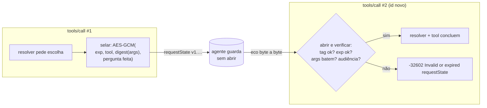

<!-- TOC -->
- [requestState: integridade, validade e opacidade](#requeststate-integridade-validade-e-opacidade)
  - [Analogia: o envelope com lacre de cera](#analogia-o-envelope-com-lacre-de-cera)
  - [Como foi feito](#como-foi-feito)
  - [Respostas às perguntas do avaliador](#respostas-às-perguntas-do-avaliador)
  - [Gerar e exportar a chave](#gerar-e-exportar-a-chave)
<!-- TOC -->

# requestState: integridade, validade e opacidade

## Analogia: o envelope com lacre de cera

O servidor entrega ao cliente um envelope com tudo o que ele precisa para continuar o atendimento depois. O cliente carrega o envelope, mas **não pode alterá-lo**: se o lacre for violado, o servidor percebe e recusa. O envelope tem **data de validade**. E quem carrega o envelope (o agente) não o abre: só guarda e devolve.

## Como foi feito

O servidor usa o mecanismo do próprio SDK oficial (`mcp` 2.3.0), sem reimplementar criptografia:

- `RequestStateSecurity(keys=[REQUEST_STATE_SECRET], ttl=REQUEST_STATE_TTL_SECONDS, bind_principal=None)` em [server.py](../servidor-mcp/src/mcp_server/server.py).
- O `RequestStateBoundary` do SDK sela todo `requestState` que sai num `input_required` e verifica todo `requestState` que volta, **antes** de qualquer código da tool rodar.
- Codec: **AES-256-GCM** (AEAD) com chave derivada por HKDF-SHA256. Isso dá integridade (qualquer byte trocado invalida a tag) e, de quebra, confidencialidade.
- O envelope selado carrega: versão, `iat`, `exp` (TTL), método, nome da tool, **digest dos argumentos originais**, audiência (nome do servidor) e o estado da rodada (perguntas feitas e respostas).



## Respostas às perguntas do avaliador

| Pergunta | Resposta |
|---|---|
| E se eu trocar um caractere? | A tag GCM não confere → `-32602`. |
| E se eu reenviar com outros argumentos? | O digest dos argumentos selado não confere → `-32602` (o caminho "rejeitar" que o enunciado aceita). |
| Quanto tempo vale? | `REQUEST_STATE_TTL_SECONDS`, padrão **600 s (10 min)**; a configuração só aceita valores entre 300 e 1800 s. |
| E depois de reiniciar o servidor? | Funciona: nada fica em memória entre as rodadas, e a chave vem do `.env`, estável entre restarts. |
| De onde vem a chave? | Só de `REQUEST_STATE_SECRET` (mínimo 32 bytes). O servidor não sobe sem ela; não há segredo no código. |
| O agente lê o conteúdo? | Não. [mcp_host.py](../agente/src/agent/mcp_host.py) só ecoa a string; o valor nunca é logado nem posto em spans (só um hash curto no servidor). |

## Gerar e exportar a chave

```bash
make secret      # cria .env (se não existir) e preenche REQUEST_STATE_SECRET só se estiver vazio
# ou, manualmente:
python3 -c "import secrets; print(secrets.token_hex(32))"
export REQUEST_STATE_SECRET=<valor gerado>
```

Nunca versione o valor: o `.env` está no `.gitignore`, e o `.env.example` só tem os nomes.
