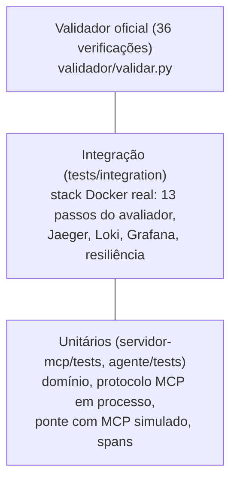
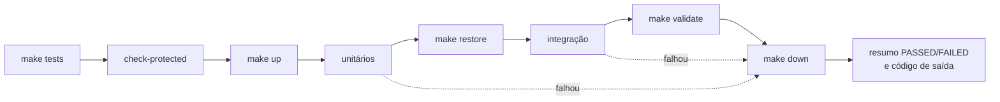

<!-- TOC -->
- [Testes](#testes)
  - [Pirâmide](#pirâmide)
  - [Como rodar](#como-rodar)
<!-- TOC -->

# Testes

## Pirâmide



Analogia: a **inspeção de um carro**. Os unitários testam cada peça na bancada (freio, farol). A integração liga o carro e dá uma volta no quarteirão. O validador é a vistoria oficial, com o checklist do órgão.

| Camada | Onde | O que cobre |
|---|---|---|
| Unitários do servidor | [servidor-mcp/tests/unit](../servidor-mcp/tests/unit) | mensagens exatas, ordem das validações, janela/duração, sobreposição, alternativas (ordem, empate, limite 3), app ASGI real em processo: `_meta` faltando, headers divergentes, ciclo MRTR completo, adulteração, argumentos trocados, restart com o mesmo segredo, segredo diferente, `-32021`, log com `traceparent` sem vazar `requestState`, exemplars |
| Unitários do agente | [agente/tests/unit](../agente/tests/unit) | parser, máquina de estados, `traceparent`, card, ponte inteira com MCP simulado via `respx` (pausa, retry com id novo e `requestState` ecoado, escolha inválida, recusa, erro de tool, erro de protocolo, Task terminal, duas Tasks pausadas, nada vaza), spans com `InMemorySpanExporter`, exemplars |
| Integração | [tests/integration](../tests/integration) | os 13 passos do "Fluxo do avaliador" do TASK.md, extras da ponte, traces no Jaeger, logs no Loki, datasources e dashboards do Grafana, tudo funcionando com Jaeger/Loki/Alloy parados |
| Validador | [validador/validar.py](../validador/validar.py) | as 36 verificações oficiais, sempre com processos recém-iniciados (`make validate` faz `restore` antes) |

## Como rodar



```bash
make test-unit          # up -> unitários dos dois serviços -> down
make test-integration   # up -> restore -> integração -> down
make tests              # tudo acima + validador oficial
make validate           # só o validador (com restore antes), saída também em validacao.log
```

Todos os alvos de teste sobem a stack antes e a derrubam depois, mesmo quando um teste falha, e terminam com o código de saída do teste.

Para depurar com a stack de pé:

```bash
make up
cd servidor-mcp && mise exec -- uv run pytest -q -k mrtr
cd agente && mise exec -- uv run pytest -q -k bridge
mise exec -- uv run pytest -q tests/integration -k step12
```
