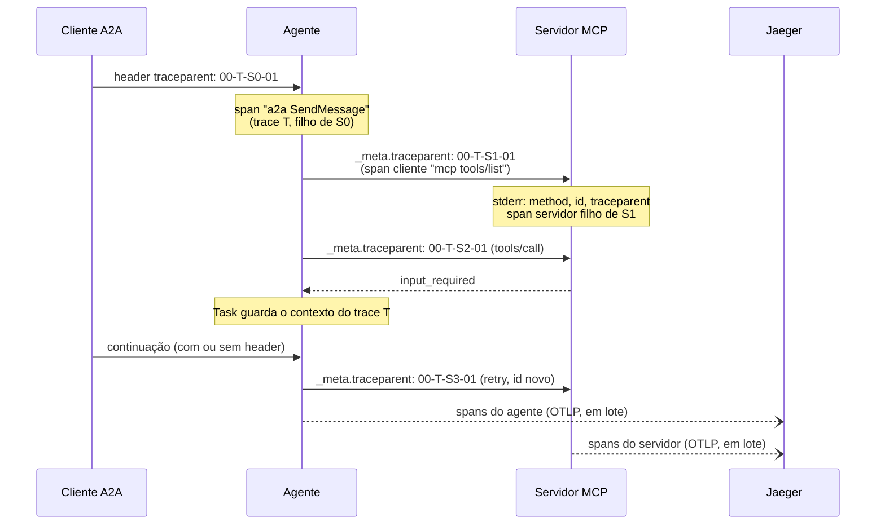
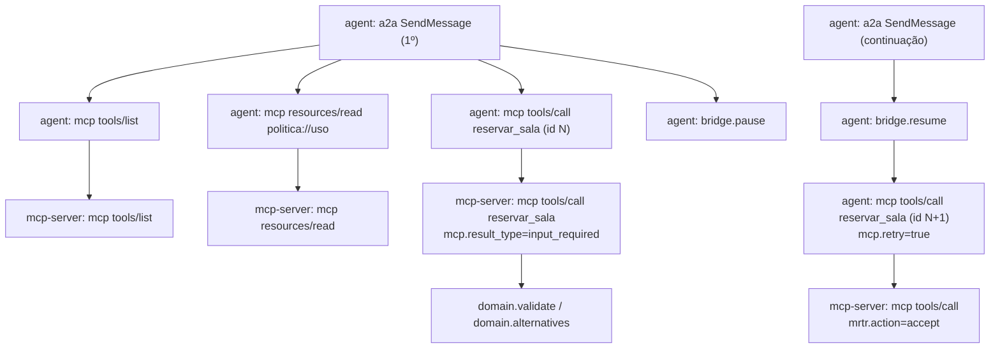
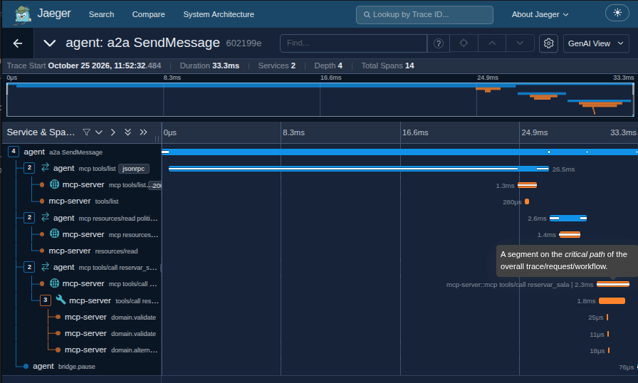
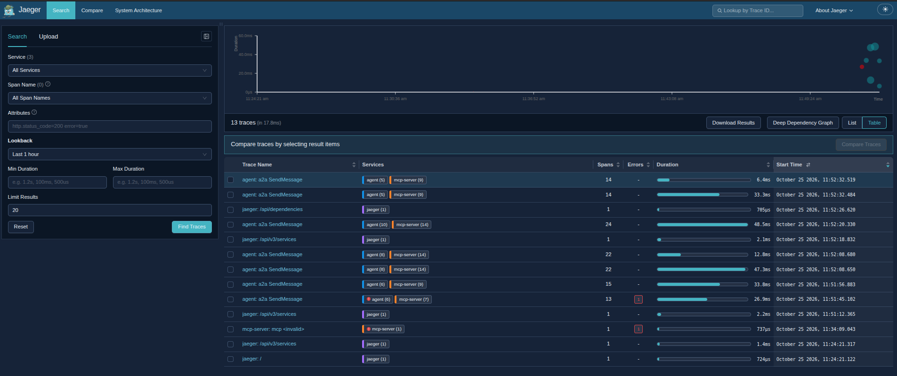

<!-- TOC -->
- [Propagação do traceparent e traces no Jaeger](#propagação-do-traceparent-e-traces-no-jaeger)
  - [Analogia: o código de rastreio da encomenda](#analogia-o-código-de-rastreio-da-encomenda)
  - [O caminho do trace-id](#o-caminho-do-trace-id)
  - [Árvore de spans de um pedido com pausa](#árvore-de-spans-de-um-pedido-com-pausa)
  - [Como achar o trace do validador](#como-achar-o-trace-do-validador)
  - [Configuração](#configuração)
<!-- TOC -->

# Propagação do traceparent e traces no Jaeger

## Analogia: o código de rastreio da encomenda

O cliente A2A cola uma etiqueta com o **código de rastreio** (o trace-id) no pedido. Cada parada do caminho (agente, chamada MCP, servidor MCP) registra um evento novo (um span, com span-id próprio), mas sempre com o **mesmo código**. No fim dá para ver o trajeto inteiro no Jaeger, e o servidor MCP também anota o código no seu stderr.

## O caminho do trace-id



- O trace-id do cliente é mantido em **todos** os requests MCP da Task; o span-id é novo em cada um ([tracing.py](../agente/src/agent/tracing.py), [mcp_host.py](../agente/src/agent/mcp_host.py)).
- O servidor MCP lê o contexto de `params._meta.traceparent`, o canal que a spec reserva, e não de um header HTTP ([observability_mw.py](../servidor-mcp/src/mcp_server/observability_mw.py)).
- Se a continuação chega **sem** header (o validador faz isso), o agente usa o contexto guardado na Task, e o retry continua no mesmo trace.
- Com `OTEL_SDK_DISABLED=true`, o agente monta o `traceparent` à mão: a propagação e o log não dependem do OpenTelemetry nem do Jaeger.

## Árvore de spans de um pedido com pausa



Atributos úteis: `rpc.jsonrpc.request_id`, `mcp.method`, `mcp.name`, `mcp.result_type`, `mcp.retry` (string `"true"`/`"false"`: o Grafana não lê atributos bool pelo `/api/v3`), `mrtr.action`, `a2a.task_id`, `a2a.task_state`. O `requestState` nunca vai para um span; o servidor registra só `request_state.sha256_8`, um hash curto.

No Jaeger, o primeiro `SendMessage` de um pedido com conflito aparece assim: `tools/list`, `resources/read politica://uso`, `tools/call reservar_sala` (com `domain.validate` e `domain.alternatives` no servidor) e, por fim, `bridge.pause` no agente.



## Como achar o trace do validador

```bash
make validate                         # 1ª linha: "trace-id desta execucao: <id>"
make traces TRACE_ID=<id>             # imprime http://localhost:16686/trace/<id>
make logs-mcp | grep <id>             # o mesmo trace-id no stderr do servidor MCP
```

Também dá para ver no Grafana: dashboard **Correlação** ou Explore → Jaeger → Trace ID.

Sem o trace-id em mãos, use a busca do Jaeger (http://localhost:16686, **Search** → **Find Traces**): cada `agent: a2a SendMessage` lista os spans do `agent` e do `mcp-server` no mesmo trace, e os que terminaram em erro trazem a marca vermelha na coluna **Errors**.



## Configuração

| Variável | Padrão | Efeito |
|---|---|---|
| `OTEL_EXPORTER_OTLP_ENDPOINT` | `http://jaeger:4318` no compose; vazio fora dele | destino OTLP/HTTP (vazio = spans só locais, sem exportação) |
| `OTEL_SERVICE_NAME` | `agent` / `mcp-server` | nome do serviço no Jaeger |
| `OTEL_SDK_DISABLED` | `false` | desliga o OpenTelemetry |
| `JAEGER_UI_PORT` / `JAEGER_OTLP_HTTP_PORT` | `16686` / `4318` | portas publicadas no host |

Se o Jaeger cair, cada processo registra **um único** aviso (`OTLP export to ... failed ... requests are not affected`) e segue atendendo normalmente.
